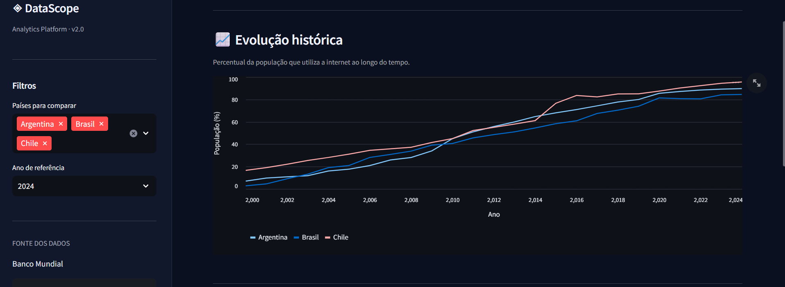

# 📊 DataScope — Internet Access Analytics

[](https://github.com/lucOlivbr/DataScope/actions/workflows/python-tests.yml)

### 🚀 Demonstração online

👉 [Acessar o DataScope — Dashboard Interativo](https://datascope-lucolivbr.streamlit.app/)

Dashboard interativo para explorar a evolução do uso da internet no Brasil, Argentina e Chile, utilizando dados públicos do Banco Mundial.



O projeto combina coleta de dados via API, tratamento com Python e Pandas, armazenamento em SQLite, consultas SQL e visualização interativa com Streamlit.

## Funcionalidades

- Coleta de dados reais da API do Banco Mundial.
- Análise histórica do percentual da população que utiliza a internet.
- Comparação entre Brasil, Argentina e Chile.
- Filtros interativos por país e ano.
- Ranking e indicadores calculados a partir dos dados.
- Insights descritivos automáticos.
- Exportação dos dados filtrados em CSV.
- Contrato de qualidade compartilhado entre coleta, carga SQL e dashboard: tipos, valores ausentes, países, anos, percentuais e duplicatas.

## Tecnologias

- **Python** — processamento e integração.
- **Pandas** — manipulação dos dados.
- **SQLite / SQL** — armazenamento e consultas.
- **Streamlit** — dashboard interativo.
- **Matplotlib** — geração do gráfico estático.
- **Requests** — integração com a API.

## Como executar

Recomendado: Python 3.12.

Clone o repositório e, na pasta do projeto, instale as dependências:

```bash
python -m pip install -r requirements.txt
```

Para atualizar os dados a partir da API e criar o banco SQLite:

```bash
python main.py
python analise_sql.py
```

Inicie o dashboard:

```bash
python -m streamlit run app.py
```

A aplicação será aberta localmente no navegador.

## Fonte dos dados

**Banco Mundial — World Development Indicators**

Indicador: `IT.NET.USER.ZS` — indivíduos que utilizam a internet (% da população).

Período coletado: 2000 a 2024, conforme disponibilidade dos dados.

API: https://api.worldbank.org/v2/

## Exemplo de resultado

Na comparação de 2024:

| País | População que utiliza a internet |
|---|---:|
| Chile | 95,59% |
| Argentina | 89,67% |
| Brasil | 84,46% |

O Chile apresentou o maior percentual entre os três países, ficando 11,13 pontos percentuais acima do Brasil.

Esses resultados são descritivos e não demonstram relações de causa e efeito.

## Objetivo

Projeto de portfólio desenvolvido para praticar conceitos de ciência de dados, integração com APIs, análise exploratória, SQL e desenvolvimento de dashboards interativos.

## Qualidade e testes

O módulo `qualidade_dados.py` valida os dados antes de gravar o CSV, carregar o SQLite ou calcular indicadores no dashboard. Dados inválidos geram erro explícito em vez de serem descartados silenciosamente ou agregados por média.

O contrato atual é específico ao indicador: Brasil, Argentina e Chile; anos inteiros de 2000 a 2024; percentuais finitos de 0 a 100; uma observação por país/ano. Lacunas de publicação são permitidas, sem imputação. Ao ampliar a coleta, atualize o contrato e os testes juntos.

```bash
python -m unittest discover -s tests -v
```

Verificado localmente em 24/10/2026: **9 testes, todos aprovados**, sem chamadas de rede. A suíte cobre normalização sem alterar a origem, esquema incompleto, base vazia, duplicatas, países/anos/percentuais inválidos, limites 0/100 e round-trip dos dados versionados entre CSV e SQLite em memória. A consulta de ranking também foi executada com sucesso.

Este é um projeto de análise de indicadores públicos. Ele demonstra integração, qualidade de dados e SQL; não implementa negociação, precificação ou modelos quantitativos financeiros.

A integração contínua em `.github/workflows/python-tests.yml` executa a suíte em Python 3.12 a cada push em `main`, pull request ou acionamento manual. O fluxo instala as dependências do projeto, verifica sua consistência com `pip check` e confere a sintaxe dos módulos. Os testes usam dados versionados e SQLite em memória, sem consultar a API do Banco Mundial. O estado da execução mais recente pode ser consultado no badge acima.

## Próximas melhorias

- Ampliar a cobertura de indicadores.
- Documentar atualização e proveniência de novas extrações.

